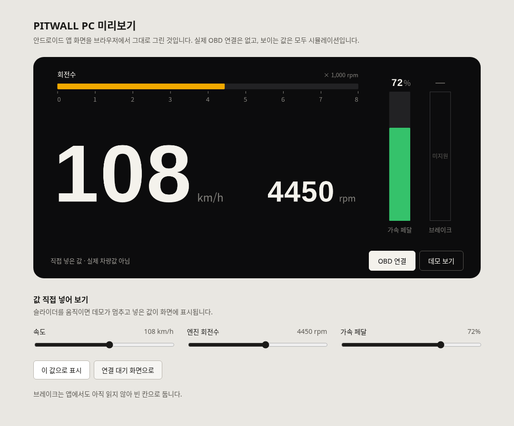

# PITWALL

현재 배포본은 **v0.8**입니다. 회전수와 가속 페달 게이지가 연속된 막대로 움직이며 수치는 바뀐 자릿수만 90ms 동안 전환합니다. [안드로이드 APK](downloads/pitwall-prototype.apk) · [개선 계획과 평가 결과](REVIEW-v0.6.md)

토레스 J150에서 OBD-II 동글을 이용해 속도, 엔진 회전수, 가속 입력을 확인하기 위한 안드로이드 프로토타입입니다. PC용 화면 미리보기는 `preview/index.html`을 브라우저에서 열면 됩니다. 설치나 서버가 필요하지 않습니다.

## PC에서 확인하기

- **데모 보기**: 안드로이드 앱의 데모와 같은 방식으로 값이 움직입니다.
- **슬라이더**: 속도, RPM, 가속 입력을 직접 조절합니다.
- **연결 대기 화면**: 앱을 처음 열었을 때의 화면으로 돌아갑니다.
- PC 미리보기에는 실제 블루투스 OBD 연결 기능이 없습니다. 표시값은 시뮬레이션입니다.

## 안드로이드에서 사용하기

`downloads/pitwall-prototype.apk`를 안드로이드 폰에 설치합니다. Android 6 이상, 64비트 ARM 기기(arm64-v8a)를 대상으로 빌드했습니다. 폰의 블루투스 설정에서 동글을 먼저 페어링하고 앱에서 **OBD 연결**을 눌러 선택합니다. Android 12 이상은 주변 기기 권한을 허용하면 동글 선택 화면이 열립니다. 일반 블루투스 SPP 방식 ELM327 호환 동글을 대상으로 하며 BLE 전용 제품은 지원하지 않습니다.

속도(PID 0D), RPM(0C), 가속 페달 D(49)를 표준 OBD-II로 요청합니다. 페달 D를 읽지 못하면 스로틀 위치(11)로 전환하고 화면의 이름을 바꿉니다. 두 값은 서로 다른 센서값입니다. 브레이크는 아직 읽지 않습니다. 차량, ECU, 동글의 지원에 따라 일부 또는 모든 값이 표시되지 않을 수 있습니다. 토레스 J150 실차와는 아직 검증하지 않았습니다. 앱은 휴대폰 가로 화면용이며 Android Auto 출력은 지원하지 않습니다.

APK는 프로토타입 서명키로 서명된 테스트 빌드입니다. 신뢰할 수 있는 경로로 설치하고, 조작은 정차 중에 하세요.

## 구조와 소스 빌드

OBD 응답 분석과 단위 변환은 Rust (`telemetry`)로 구현했으며, 블루투스 SPP 연결과 안드로이드 화면은 Java로 구현했습니다. 이 앱 전체가 순수 Rust로 작성된 것은 아닙니다. Android Studio에서 루트 폴더를 엽니다. Android SDK 35, Android NDK r27d, Rust를 설치하고 `rustup target add aarch64-linux-android`를 실행하세요. Android Studio를 실행하는 환경에서 `ANDROID_NDK_HOME`을 NDK 경로로, `PATH`에 `cargo`를 설정한 뒤 `app`을 빌드합니다. Gradle의 `preBuild`가 Rust 라이브러리를 빌드해 APK에 포함합니다. 최소 SDK 23, 대상 SDK 35이며 현재 arm64-v8a만 빌드합니다. Rust 테스트는 `cd telemetry && cargo test`로 실행합니다. PC 미리보기는 별도의 빌드 과정이 없습니다.

제공된 APK는 `scripts/build-apk.sh`(Linux, JDK·SDK·NDK·Rust 필요)로 빌드하고 서명 및 ZIP 정렬을 검증했으며, Gradle 빌드와 실제 휴대폰 동작은 이 환경에서 아직 검증하지 않았습니다.

## v0.3 리뷰 및 지연 개선

- 연결마다 소켓을 분리하고 이전 연결의 콜백을 무시합니다. 이전 스레드가 새 연결을 닫거나 값을 지우는 경쟁 조건을 수정했습니다.
- 메인 스레드의 최대 500ms `join` 대기를 제거했습니다. 백그라운드 전환 시 통신과 데모를 중지합니다.
- `available()` + 10ms sleep 대신 버퍼를 둔 blocking read를 사용합니다. 연결 및 명령 타임아웃은 해당 소켓을 닫아 read를 해제합니다.
- 고정 100ms UI 갱신을 제거하고 데이터 도착 후 다음 프레임에 그립니다. 글꼴 객체를 재사용하며 상태 문구가 바뀔 때만 레이아웃을 갱신합니다.
- 가속 입력을 우선 요청하고 그 사이 보조 PID를 하나만 읽습니다. RPM은 최대 5Hz, 속도는 최대 2Hz로 요청합니다. ELM adaptive timing을 활성화하며 임의로 ECU 응답 시간 제한을 공격적으로 줄이지 않습니다.
- Rust 파서는 각 줄을 독립적으로 검사합니다. 불완전한 프레임을 다른 줄과 합치거나 잡음에서 가짜 수치를 추출하지 않습니다. 임시 문자열 할당을 줄였습니다.
- Rust release 빌드에 LTO, 심볼 제거, 16KB 메모리 페이지 정렬을 적용했습니다.

화면의 **입력 Hz**는 초당 유효한 가속 페달 또는 스로틀 응답 수이며 **응답 ms**는 마지막 입력 요청 시작부터 ELM 프롬프트 수신까지의 시간입니다. 센서부터 화면까지의 전체 지연을 의미하지 않습니다. RPM/속도 요청 중에는 입력 요청이 기다리며, 동글·ECU 자체 지연은 소프트웨어만으로 없앨 수 없습니다. 미지원 값은 대시로 표시하며, 타임아웃은 연결을 종료합니다. 성공한 마지막 값은 후속 요청 완료 또는 타임아웃까지 유지됩니다.

### 검증

- `cargo test --locked --manifest-path telemetry/Cargo.toml`: 정상/오류/잘린 프레임 파싱 테스트
- `javac -d build/tests app/src/main/java/com/torquescope/ElmTransport.java tests/ElmTransportTest.java` 후 `java -cp build/tests com.torquescope.ElmTransportTest`: 프롬프트 경계, 순차 응답, 타임아웃 취소, EOF, 막힌 read 해제, 크기 제한
- Android ARM64 네이티브 라이브러리 및 APK 컴파일, 서명과 정렬 확인
- PC 미리보기: 데모, 수동 입력, 초기화, 연결 미지원 안내 확인

실제 토레스/동글에서의 전후 지연 측정, Android 화면 수명주기·블루투스 실기기 테스트는 아직 수행하지 않았습니다. PC 미리보기는 화면 시뮬레이션이며 Rust/JNI·블루투스 경로를 테스트하지 않습니다.

## v0.4 화면

온보드 중계 그래픽의 청회색 톤과 기울어진 숫자에서 출발해, 곡면 없이 평면 레이아웃으로 정리했습니다. 왼쪽 속도, 오른쪽 가속/브레이크, 하단 RPM 순서이며 Android 앱과 PC 미리보기에 함께 반영했습니다. OBD 처리 방식은 v0.3과 동일합니다.

## v0.5 화면

계기판처럼 한눈에 읽히도록 다시 그렸습니다. 검정 바탕에 속도를 가장 크게 두고, 위쪽에 1000 rpm 단위로 나뉜 회전수 바, 오른쪽에 가속 페달과 브레이크 세로 바를 둡니다. 영문 소제목과 장식 선, 기울인 숫자, 청회색 톤은 뺐고 단위(km/h, rpm)와 한글 이름만 남겼습니다. 브레이크는 아직 읽지 않아 빈 칸에 "미지원"으로 표시합니다. 아래 상태 줄은 연결 중일 때만 입력 Hz와 응답 ms를 붙여 보여 줍니다. Android 앱과 PC 미리보기가 같은 좌표로 그리며, OBD 처리 방식은 v0.3과 동일합니다.

v0.5 APK는 이 빌드 환경에서 새로 만든 프로토타입 키로 서명했습니다. 이전 APK와 서명이 달라 덮어쓰기 설치가 되지 않으니, 기존 앱을 삭제한 뒤 설치하세요. 실제 휴대폰 화면에서는 아직 확인하지 않았습니다.

